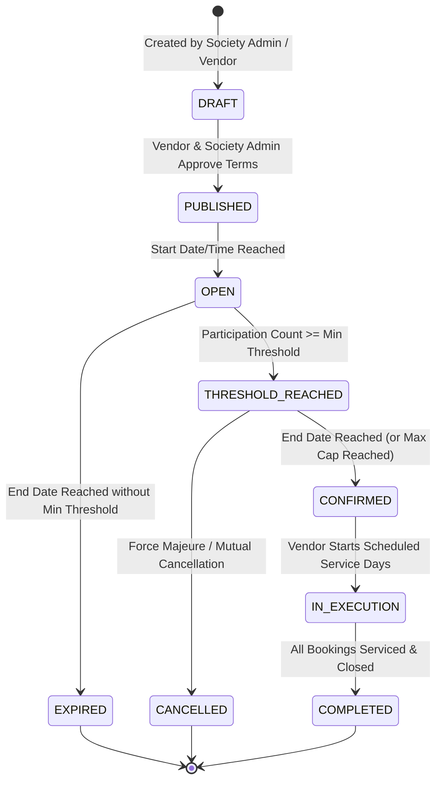

# SocietySaver — Group-Buying Engine & Pricing Rules Specification

## 1. Core Principles

The group-buying engine is the platform's core value driver. It aggregates demand within a specific residential society to unlock tiered volume discounts with vetted vendors.

### Non-Negotiable Invariants:
1. **Accurate Representation**: Never claim a discount or threshold has been reached unless persistent database state validates that claim.
2. **Deterministic Pricing**: Price quotes and calculations must use exact integer arithmetic in paise.
3. **Concurrency Safety**: Deal participation and booking reservations must be atomic, preventing overselling or invalid threshold counts under concurrent load.
4. **Transparent Semantics**: The rules governing refunds, repricing, and threshold failures must be declared upfront before a resident joins.

---

## 2. Tiered Pricing Model & Calculation

A deal specifies an ordered list of pricing tiers:

$$\text{Tier}_k = [\text{min\_units}_k, \text{max\_units}_k] \rightarrow \text{unit\_price}_k$$

### Canonical Example: Split AC Deep Cleaning
- **Standard Individual Price**: ₹999 per unit (99,900 paise)
- **Tier 1 (1–4 units)**: ₹800 per unit (80,000 paise) — 20% savings
- **Tier 2 (5–9 units)**: ₹700 per unit (70,000 paise) — 30% savings
- **Tier 3 (10–19 units)**: ₹600 per unit (60,000 paise) — 40% savings
- **Tier 4 (20+ units)**: ₹500 per unit (50,000 paise) — 50% savings

### Mathematical Pricing Function:
Given total confirmed participating units $U$:

$$\text{ActiveTier}(U) = \arg\max_{k} \{ \text{Tier}_k \mid U \ge \text{min\_units}_k \}$$

$$\text{ApplicableUnitPrice}(U) = \text{unit\_price}_{\text{ActiveTier}(U)}$$

$$\text{UnitsToNextTier}(U) = \begin{cases} \text{min\_units}_{\text{ActiveTier}(U) + 1} - U & \text{if next tier exists} \\ 0 & \text{if top tier reached} \end{cases}$$

---

## 3. Pricing Semantics

SocietySaver supports two explicitly defined pricing modes:

### Mode A: Uniform Final-Tier Pricing (Default)
All confirmed participants pay the final price tier achieved when the deal campaign closes.
- **Workflow**:
  1. When joining, the resident authorizes an initial charge or pre-authorization based on the active tier price at join time: $\text{Price}_{\text{initial}}$.
  2. As additional neighbors join and higher tiers are unlocked, the deal unit price decreases.
  3. Upon deal closure, the final tier unit price $\text{Price}_{\text{final}}$ is locked.
  4. If $\text{Price}_{\text{final}} < \text{Price}_{\text{initial}}$, the system automatically issues an adjusting refund credit or captures only the final lower amount.
  5. The resident receives an itemized receipt showing the initial quote, final locked tier, and total savings.

### Mode B: Prospective Tier Pricing
Each participant locks the price corresponding to the tier active at their exact moment of joining. Subsequent tier unlocks apply only to subsequent joiners.

---

## 4. Deal State Machine



### State Definitions & Transition Triggers:
1. **`DRAFT`**: Deal is being configured (tiers, dates, service limits). Not visible to residents.
2. **`PUBLISHED`**: Approved by both society admin and vendor. Visible to residents with an upcoming countdown timer.
3. **`OPEN`**: Residents can actively join, select units, and commit bookings.
4. **`THRESHOLD_REACHED`**: The minimum participation threshold has been met; the deal is guaranteed to execute once the timer expires.
5. **`CONFIRMED`**: Deal timer elapsed with threshold met (or max cap reached). Pricing tier is permanently locked. Bookings are converted and dispatched to vendor schedule.
6. **`EXPIRED`**: Deal deadline elapsed without reaching `min_participants`. Any pre-authorizations are released, and residents are notified immediately.
7. **`CANCELLED`**: An active deal is cancelled by admin intervention. Immediate 100% refund initiated for all participants.
8. **`COMPLETED`**: All associated service bookings have been completed and verified.

---

## 5. Concurrency & Integrity Controls

### Preventing Race Conditions & Overselling:
1. **Row Locking on Join**:
   ```sql
   SELECT id, current_participant_count, max_participants, status 
   FROM group_deals 
   WHERE id = :deal_id 
   FOR UPDATE;
   ```
2. **Atomic Verification**:
   - Verify `status IN ('OPEN', 'THRESHOLD_REACHED')`.
   - Verify `current_time BETWEEN start_time AND end_time`.
   - Verify `current_participant_count + new_units <= max_participants`.
3. **Atomic Increment**:
   - Increment `current_participant_count`.
   - Insert `deal_participants` record.
   - If `current_participant_count >= min_participants` and `status == 'OPEN'`, transition to `THRESHOLD_REACHED`.
4. **Idempotent Join Requests**:
   - Check unique constraint on `(deal_id, user_id)` to prevent double-joining from rapid double-clicks.
